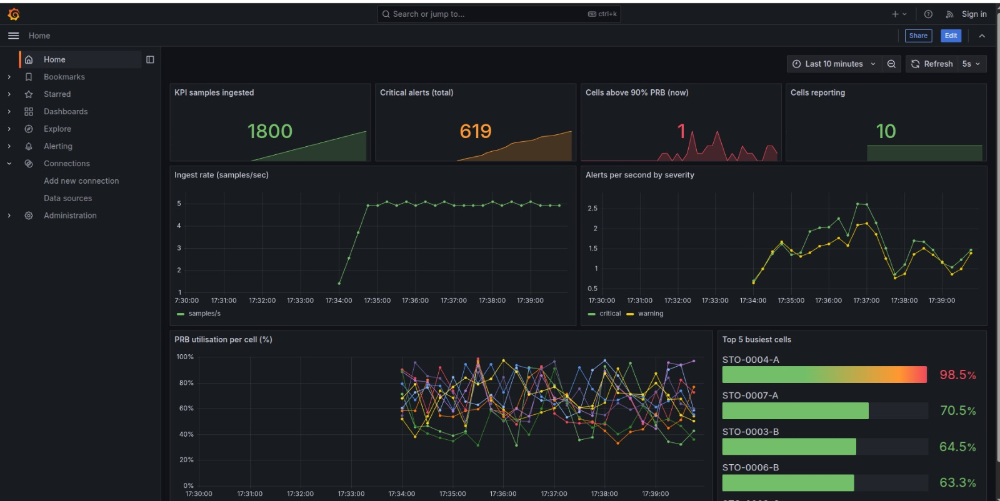

# CellPulse

A small FastAPI service that ingests radio-cell KPIs (PRB utilisation, drop-call rate, latency), raises alerts and exposes Prometheus metrics.

## What's inside

- **App:** FastAPI, threshold-based alert rules, `/metrics` for Prometheus
- **Packaging:** multi-stage non-root Docker image, Helm chart
- **Monitoring:** Prometheus + Grafana dashboard, fed by a traffic simulator
- **CI/CD:** GitHub Actions (`.github/workflows/ci.yml`) and GitLab CI (`.gitlab-ci.yml`)
- **AI failure analysis:** when CI fails, an LLM reads the failed logs and posts a root-cause summary on the pull request

## Pipeline

`lint → test (85% coverage gate) → security scans → build → image scan + SBOM → deploy to kind with Helm → smoke test → publish to GHCR (manual approval)`

| Stage | Tools |
|---|---|
| Lint and test | ruff, pytest, helm lint |
| Security | Gitleaks, Bandit, pip-audit, Trivy |
| Supply chain | Syft SBOM (CycloneDX) |
| Deploy | Helm `--atomic` on a throwaway kind cluster |
| Release | GHCR, gated by the `production` environment |

Dependabot opens weekly update PRs.

## AI failure analysis

`scripts/ai_failure_analyzer.py` runs after a failed CI run. It redacts secrets from the logs, sends them to an OpenAI-compatible LLM endpoint and posts the answer on the PR. It never fails the pipeline: if the LLM is unreachable, it posts a plain log summary instead.

Configure it under **Settings → Secrets and variables → Actions**:

| Name | Type | Purpose |
|---|---|---|
| `AI_API_KEY` | secret | API key for the LLM provider |
| `AI_BASE_URL` | variable | OpenAI-compatible base URL |
| `AI_MODEL` | variable | model name |
